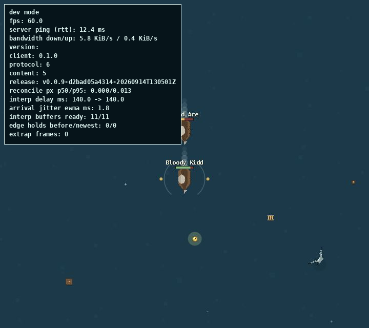

# Flag of Yore

- **Challenge author:** abcjr
- **Category:** Miscellaneous
- **Question:** Q2 — Flag of Yore
- **Points:** 109
- **Challenge:** sea-of-theft / Flag of Yore
- **Flag format:** `DCTF{string}`

## TL;DR

The live game included a tutorial screenshot from an older development build. The screenshot displayed the old release's full version ID. Using the same URL layout as the current release, I downloaded that historical build's asset index. It listed a forgotten `dev.pak` containing `flag.txt`.

```text
DCTF{M4yb3_cl34n_y0ur_S3_buCk375_fr0m_t1m3_t0_71m3}
```

The flag reads: **“Maybe clean your S3 buckets from time to time.”**

---

## Challenge description and initial analysis

The prompt described becoming a “true historian.” The game’s production assets supplied an older development screenshot, pointing toward release archaeology rather than gameplay.

## What are we looking at?

Opening the challenge gives us a browser-based pirate MMO called **PiP World 2**. We can sail around, collect loot, fight ships, and generally get distracted by the fact that this is a surprisingly complete game for a CTF challenge.

The name **Flag of Yore** is our first useful clue. “Yore” means a long time ago, while the description says that we have become a “true historian.” That strongly suggests that this question is not about winning the current game. We probably need to find something left behind by an **older version**.

## Step 1: Finding the current release information

The page source contains a JavaScript object called `pin`. This tells the browser exactly which game build it should load:

```javascript
const pin = Object.freeze({
    "builtAt": "2026-09-15T11:08:11Z",
    "hash": "cb5550c729d98d1371d074c0ba6397079ae5c107dfe6009c6dcffb71ff8c2aa7",
    "id": "v0.1.1-cb5550c729d9-20260915T110811Z",
    "manifestUrl": "https://sot-chall-test-versions.abcjr.dev/releases/prod/v0.1.1-cb5550c729d9-20260915T110811Z/release.json",
    "variant": "prod",
    "version": "0.1.1"
});
```

This is basically a shipping label for the current game. It gives us:

- the version number;
- the exact release ID;
- the build date;
- whether it is a production or development build; and
- the location of its release manifest.

We can download that manifest with `curl`:

```bash
curl -sS \
  https://sot-chall-test-versions.abcjr.dev/releases/prod/v0.1.1-cb5550c729d9-20260915T110811Z/release.json \
  -o release.json
```

The important part of `release.json` is its file list:

```json
{
  "files": {
    "assetIndex": {
      "path": "assets.idx"
    },
    "datapack": {
      "path": "pipworld2.dat"
    },
    "entry": {
      "path": "pipworld2-client-490b8d797804be51.js"
    },
    "wasm": {
      "path": "pipworld2-client-490b8d797804be51_bg.wasm"
    }
  }
}
```

The interesting file for this question is `assets.idx`. It is the game's asset catalogue: a small binary index telling the client which packs and resources exist.

## Step 2: Looking through the current assets

I downloaded the index and used `strings` to pull readable words from it:

```bash
BASE='https://sot-chall-test-versions.abcjr.dev/releases/prod/v0.1.1-cb5550c729d9-20260915T110811Z'

curl -sS "$BASE/assets.idx" -o assets.idx
strings -a assets.idx
```

The output included names such as:

```text
pickups
tutorial
doubloon
bottle
keg
tutorial_sail
tutorial_fire
tutorial_boost
tutorial_plunder
dev_tutorial
```

`dev_tutorial` stood out. Why would a production release still contain a development tutorial image?

The matching pack was still downloadable:

```bash
curl -sS "$BASE/tutorial.pak" -o tutorial.pak
```

The pack starts with a small 24-byte header. After that, it contains five raw `720 × 640` RGBA images. RGBA means four bytes per pixel: one each for red, green, blue, and transparency. Therefore, each image occupies:

```text
720 × 640 × 4 = 1,843,200 bytes
```

This short Python script extracts them:

```python
from PIL import Image

names = [
    "tutorial_sail",
    "tutorial_fire",
    "tutorial_boost",
    "tutorial_plunder",
    "dev_tutorial",
]

data = open("tutorial.pak", "rb").read()
width, height = 720, 640
image_size = width * height * 4
header_size = 24

for i, name in enumerate(names):
    start = header_size + i * image_size
    pixels = data[start:start + image_size]
    Image.frombytes("RGBA", (width, height), pixels).save(f"{name}.png")
```

The last extracted file was the important one:



## Step 3: Reading the leaked historical release ID

The top-left corner of `dev_tutorial.png` contains a developer status panel. Among the frame rate and network statistics is this line:

```text
release: v0.0.9-d2bad05a4314-20260914T130501Z
```

This is an older version than the live `v0.1.1` release, and the screenshot literally says `dev mode`. That gives us everything needed to try reconstructing the old URL:

- replace the current `prod` release directory with `dev`;
- replace the current release ID with the leaked `v0.0.9` ID.

The resulting historical manifest URL is:

```text
https://sot-chall-test-versions.abcjr.dev/releases/dev/v0.0.9-d2bad05a4314-20260914T130501Z/release.json
```

Testing it gives a real manifest:

```bash
OLD_BASE='https://sot-chall-test-versions.abcjr.dev/releases/dev/v0.0.9-d2bad05a4314-20260914T130501Z'

curl -sS "$OLD_BASE/release.json" -o old-release.json
cat old-release.json
```

The response confirms that it is version `0.0.9`, was built on September 14, and has the `dev` variant:

```json
{
  "release": {
    "builtAt": "2026-09-14T13:05:01Z",
    "id": "v0.0.9-d2bad05a4314-20260914T130501Z",
    "variant": "dev",
    "version": "0.0.9"
  }
}
```

The developers had deployed a newer version, but they had not removed the old one from their public release storage. That is exactly the sort of mistake hinted at by “Flag of Yore.”

## Step 4: Inspecting the old asset index

Next, I downloaded the historical release's asset index:

```bash
curl -sS "$OLD_BASE/assets.idx" -o old-assets.idx
strings -a old-assets.idx
```

The old index contains two entries that the current production index does not:

```text
dev
flag.txt
```

The names are packed together in the binary string table, so a hex dump also makes the ending easy to spot:

```bash
xxd -g1 old-assets.idx | tail
```

Near the end, the ASCII column shows:

```text
...dev_tutorialflag.txt
```

This tells us that the old release had a pack named `dev`, and that pack included an asset named `flag.txt`.

## Step 5: Downloading the forgotten development pack

Release files are stored beside their manifest, so the likely pack name is simply `dev.pak`:

```bash
curl -sS "$OLD_BASE/dev.pak" -o dev.pak
wc -c dev.pak
```

It is only 76 bytes long:

```text
76 dev.pak
```

Running `strings` is enough to recover its contents:

```bash
strings -a dev.pak
```

Output:

```text
PPAK
DCTF{M4yb3_cl34n_y0ur_S3_buCk375_fr0m_t1m3_t0_71m3}
```

For completeness, the first 24 bytes are the pack header and the remaining 52 bytes are the flag plus a newline. We can extract the payload directly as well:

```bash
dd if=dev.pak bs=1 skip=24 status=none
```

Output:

```text
DCTF{M4yb3_cl34n_y0ur_S3_buCk375_fr0m_t1m3_t0_71m3}
```

## Why the solution fits the clues

The whole chain matches the question nicely:

- **“Yore”** points us toward a previous release.
- **“True historian”** suggests release archaeology rather than normal gameplay.
- A current asset accidentally preserves a screenshot of the past.
- The screenshot leaks an otherwise hard-to-guess release identifier.
- The old release is still publicly downloadable from an S3-style asset bucket.
- The flag itself jokes that the bucket should be cleaned occasionally.

Importantly, this did not require guessing thousands of version IDs. Modern release IDs contain hashes and timestamps, which would make blind guessing impractical. The developers handed us the precise historical ID inside their own tutorial screenshot.

## Flag

```text
DCTF{M4yb3_cl34n_y0ur_S3_buCk375_fr0m_t1m3_t0_71m3}
```

## Takeaways

- Old deployments can remain accessible even after the main application has moved on.
- Build metadata, debug overlays, screenshots, and source maps can reveal valuable internal information.
- A binary file is not automatically mysterious; `strings`, `xxd`, and basic size calculations often reveal plenty.
- Asset indexes deserve just as much attention as JavaScript and HTML.
- If release URLs include unguessable IDs, leaking one old ID can still completely defeat that protection.
- Most importantly: clean obsolete development files out of public storage from time to time.

## Reproduction and files

[`extract_tutorial.py`](extract_tutorial.py) extracts the development screenshot from the public `tutorial.pak` referenced above (Pillow required). The key small artifacts are preserved in `assets/`: redacted copies of the current and historical release manifests (game-server URLs removed), the historical asset index, screenshot, and 76-byte `dev.pak`. The multi-megabyte production pack is omitted; the writeup records its download path.
